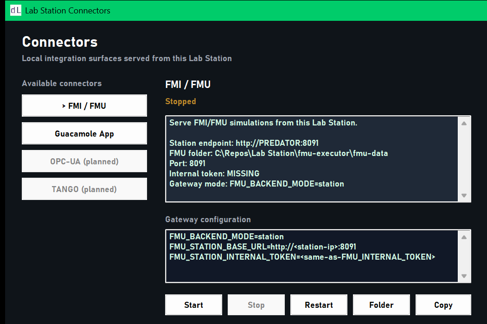

# FMU Executor

Shared Python/FastAPI service for the Windows and Linux Lab Station
implementations. `VERSION` is the source release version; the Lab Station
repositories carry release snapshots so station releases do not download
executable code at runtime. Lab Gateway's `fmu-runner` consumes the service in
`station` backend mode.

Install from this project with `python -m pip install .` or use
`requirements.txt` to build a station-local virtual environment. Keep the
same release version in both Lab Station snapshots.

Python 3.11 or newer is required by the supported runtime dependencies.

## Quick start

```bash
cd fmu-executor
pip install -r requirements.txt
python -m app
```

The service listens on `http://0.0.0.0:8091` by default. It is an internal
station service; expose the configured port only to the Lab Gateway network and
configure the same non-empty `FMU_INTERNAL_TOKEN` in the Station process
environment and Gateway's `FMU_STATION_INTERNAL_TOKEN`.

The repository's `Dockerfile` builds the container used by Lab Gateway's
optional local Executor profile. It uses the Docker Official Python image
from Amazon ECR Public. Pushing a `vX.Y.Z` tag publishes
`ghcr.io/decentralabscom/fmu-executor:X.Y.Z`; the tag must match both
`VERSION` and the package version in `pyproject.toml`. Gateway pins a
versioned image by default, so installing that profile does not require a
separate FMU-Executor checkout. Station releases continue to package the
service through their platform installers.

After the first image is published, set its GitHub Container Registry package
visibility to Public if Gateway installations must pull it without GitHub
authentication. The source repository is linked automatically by the image's
OCI source label and the publishing workflow.

On Windows, when Lab Station starts the sidecar through `LabStation\BackgroundService`,
Windows Task Scheduler runs that task as `SYSTEM`. A per-user Python install or
user-scoped `pip install` is not visible to that account. Install the
requirements into a machine-wide Python environment (or a virtual environment
under the Lab Station installation directory) and make sure the interpreter and
packages are readable by `SYSTEM`. Verify the installation in a SYSTEM shell
before starting the task, for example:

```powershell
psexec -accepteula -s -i powershell.exe
python -m pip install -r C:\LabStation\fmu-executor\requirements.txt
python -c "import uvicorn"
```

The Python interpreter used by the task must resolve the same environment; do
not rely on packages installed only for the interactive administrator account.

The same integration is visible from the Lab Station **Connectors** panel,
which reports the FMU endpoint, local model directory, port, token status, and
the Gateway environment expected for station mode:



*FMI/FMU connector view from the Lab Station desktop UI.*

## Configuration (env vars)

| Variable | Default | Description |
|---|---|---|
| `FMU_EXECUTOR_HOST` | `0.0.0.0` | Bind address |
| `FMU_EXECUTOR_PORT` | `8091` | Bind port |
| `FMU_ROOT` | `./fmu-data` | Directory with provisioned `.fmu` files |
| `FMU_EXECUTOR_STATE_DIR` | Sibling `state/` beside `FMU_ROOT` | Persistent SQLite job history and quota store |
| `FMU_INTERNAL_TOKEN` | *(required)* | Shared secret for `X-Internal-Session-Token`; requests fail closed when it is absent |
| `FMU_INTERNAL_TOKEN_FILE` | *(unset)* | Optional path to a mounted token file; used when the direct token and base64 token are unset |
| `FMU_MAX_SESSIONS` | `4` | Shared max concurrent FMU executions (runs, jobs, streams, probes and realtime) |
| `FMU_ATTACH_GRACE_SECONDS` | `120` | How long a disconnected realtime session remains attachable before its FMU state is terminated |
| `FMU_EXECUTOR_TEMP` | `<FMU_ROOT>/.tmp` | Temp dir for FMU extraction |
| `FMU_EXECUTION_MODE` | `process` | Execution boundary: `process` (recommended) or `in-process` (diagnostics only) |
| `FMU_EXECUTION_TIMEOUT_SECONDS` | `3600` | Deadline for an isolated one-shot/stream worker |
| `FMU_MAX_ARCHIVE_BYTES` | `512 MiB` | Maximum compressed FMU size |
| `FMU_MAX_EXPANDED_BYTES` | `2 GiB` | Maximum total expanded size of archive entries |
| `FMU_MAX_ARCHIVE_ENTRIES` | `20,000` | Maximum ZIP entries in an FMU |
| `FMU_MAX_MODEL_DESCRIPTION_BYTES` | `8 MiB` | Maximum `modelDescription.xml` size |
| `FMU_WORKER_CPU_SECONDS` | `300` | Per-worker CPU-time limit |
| `FMU_WORKER_MEMORY_MIB` | `1024` | Per-worker memory limit |
| `FMU_WORKER_FILE_MIB` | `128` | Linux per-file write limit; Windows AppContainer workers have no per-file quota |
| `FMU_EXECUTOR_COMMIT` | Build metadata | Source commit recorded in execution evidence |
| `FMU_MAX_INPUT_UPDATE_BYTES` | `65536` | Maximum JSON size for one `sim.setInputs` update |
| `FMU_MAX_INPUT_UPDATES_PER_DAY` | `100000` | Daily runtime input update limit per reservation and FMU |
| `FMU_MAX_INPUT_UPDATE_BYTES_PER_DAY` | `67108864` | Daily input payload limit per reservation and FMU |
| `FMU_MAX_INPUT_UPDATES_PER_WINDOW` | `30` | Short-window input update burst limit |
| `FMU_INPUT_UPDATE_WINDOW_SECONDS` | `10` | Window for the input update burst limit |
| `FMU_MAX_OUTPUT_SUBSCRIPTION_HZ` | `60` | Per-session cap for realtime output reads and samples |
| `FMU_MAX_OUTPUT_SUBSCRIPTION_BATCH` | `256` | Maximum retained samples in a subscription batch |
| `FMU_PROGRESS_INTERVAL_MS` | `50` | Minimum interval between automatic progress messages |
| `FMU_OMSIMULATOR_ENABLED` | `false` | Enables OMSimulator discovery for the future composition backend; does not switch current execution automatically |
| `FMU_OMSIMULATOR_COMMAND` | `OMSimulator` | OMSimulator executable or command name |
| `FMU_OMSIMULATOR_TIMEOUT_SECONDS` | `3600` | Reserved timeout for the future OMSimulator adapter |
| `FMU_LOG_LEVEL` | `INFO` | Log level |

For the Windows scheduled task, set the token as a machine-level environment
variable before starting the Station service:

```powershell
[Environment]::SetEnvironmentVariable('FMU_INTERNAL_TOKEN', '<random-shared-secret>', 'Machine')
```

Restart the `LabStation\BackgroundService` task after changing the
variable. The token value must be copied to Lab Gateway's
`FMU_STATION_INTERNAL_TOKEN`; do not put it in source control or in a
public connector URL. `FMU_EXECUTOR_PORT` must be a numeric TCP port from 1 to
65535. The Lab Station supervisor reads the same variable for its health checks
and creates the `LabStation-FMU-Executor` inbound rule for that port on Domain
and Private profiles. A manual `python -m app` launch does not create the
firewall rule.

## Internal API

All endpoints require `X-Internal-Session-Token` header (except `/internal/health`).

| Method | Path | Description |
|---|---|---|
| GET | `/internal/health` | Health & diagnostics |
| GET | `/internal/fmu/catalog` | FMU inventory; `X-FMU-Access-Key` header |
| GET | `/internal/fmu/describe` | Model description; `X-FMU-Access-Key` header |
| GET | `/internal/fmu/companion-asset?assetType=glb\|threejs-app` | Same-stem `.glb` or `.webapp.zip`; requires internal and FMU access-key headers |
| GET | `/internal/fmu/companion-app/{asset_path}` | One safe file from the same-stem `.webapp.zip`; requires internal and FMU access-key headers |
| GET | `/internal/fmu/capacity` | Effective execution capacity; internal token required |
| POST | `/internal/fmu/validate/{access_key}?auto_quarantine=false&probe=false` | Reports archive, station compatibility, and an optional isolated execution probe |
| POST | `/internal/fmu/quarantine/{access_key}?reason=manual` | Explicitly quarantines an FMU |
| DELETE | `/internal/fmu/quarantine/{access_key}` | Removes an FMU from quarantine |
| GET | `/internal/fmu/quarantine` | Lists quarantined FMUs |
| POST | `/internal/fmu/simulations/run` | One-shot simulation run; JSON body contains `accessKey` |
| POST | `/internal/fmu/simulations/stream` | Streaming NDJSON simulation; JSON body contains `accessKey` |
| POST | `/internal/fmu/simulations/jobs` | Submit a reservation-scoped cancellable one-shot job |
| POST | `/internal/fmu/simulations/batches` | Submit a bounded reservation-scoped batch |
| GET | `/internal/fmu/simulations/history` | Page the current reservation's history; requires `X-Gateway-Context` |
| GET | `/internal/fmu/simulations/{job_id}` | Read reservation-scoped job status |
| POST | `/internal/fmu/simulations/{job_id}/cancel` | Cancel a reservation-scoped job |
| GET | `/internal/fmu/simulations/{job_id}/result` | Read a reservation-scoped terminal result |
| WS | `/internal/fmu/sessions` | Realtime session (step, setInputs, getOutputs, authenticated reconnect) |

`catalog` and `describe` also require the `X-FMU-Access-Key` header. The
`access_key` path segment is URL-encoded when it contains nested directories.
`companion-asset` uses that same access key to resolve a sibling `.glb` or
`.webapp.zip` inside `FMU_ROOT`, returns the corresponding media type, and
rejects missing, out-of-root, or over-50-MiB assets. Lab Gateway uses the route
when the configured FMU backend is a Lab Station; local Gateway mode reads the
same companion files from local `fmu-data`.
`companion-app` serves a bounded file directly from that ZIP without extracting
it to disk. The local Smart Warehouse preview requests each Three.js asset
through the Gateway and FMU Executor, so it does not need a separate static
asset server. Production Three.js apps continue to use the Gateway's immutable
`/digital-twin-apps/` storage.

`GET /internal/fmu/backends` reports the active FMPy backend and the planned
OMSimulator backend. The same information is included in `/internal/health`.

## Runtime capabilities

The executor uses FMPy `0.3.32` through `instantiate_fmu`, so the Station
runtime selects the FMI 2 or FMI 3 Co-Simulation implementation from the FMU
model description. Realtime input/output handling includes scalar and array
variables for the FMI numeric types, Boolean, String, Binary and Clock where
the FMU runtime exposes the corresponding API. Binary values use base64 in the
JSON contract, and FMI 3 `Int64`/`UInt64` outputs are serialized as strings to
avoid loss of precision in JavaScript clients.

One-shot, NDJSON streaming, and realtime sessions run in spawned worker
processes. The API process keeps only the session registry and sends an
allowlisted control set over private IPC.
This keeps native FMU crashes and blocking calls scoped to one session while
preserving session reconnects during the configured grace period. Set
`FMU_EXECUTION_MODE=in-process` only for diagnostics or environments where
native FMU isolation is managed elsewhere.

The realtime session advertises `start`, `pause`, `resume`, `reset`, `step`,
input/output and reconnect capabilities. `reset` recreates the FMU instance
with the original initialization options and inputs. Initialization inputs are
read from `options.inputs` (the legacy top-level `parameters` object is also
accepted); runtime writes accept only declared input variables and validate all
names, types, ranges and array lengths before calling the FMU.
The FMI proxy uses `sim.reset` with `deferInitialization: true` so a subsequent
`sim.initialize` can apply the caller's updated experiment and initial inputs.

`sim.initialize.options.timeMode` selects the session clock:

- `simtime` runs automatic sessions as fast as the FMU can advance;
- `realtime` paces simulated seconds against wall-clock seconds, scaled by
  `playbackSpeed` (default `1`, allowed range `0.1` through `100`);
- `external` disables automatic start/resume and `runUntil`; clients advance it
  with `sim.step` and must send the current `currentCommunicationPoint`.

FMI 3 event mode is negotiated with the FMU and resolved inside the isolated
Executor before returning a step. Step responses include the last successful
simulation time, early-return/termination flags, and whether an event occurred.
Automatic progress messages are throttled independently of `stepSize`. Realtime
output reads share the `FMU_MAX_OUTPUT_SUBSCRIPTION_HZ` cap per session across
subscriptions, direct `sim.getOutputs` calls, and the output responses from
`sim.step` and `sim.runUntil`. Subscription `periodMs` and `maxHz` can request a
lower rate but cannot exceed the configured cap. A direct read, step or
`runUntil` request that arrives too soon returns a retryable
`OUTPUT_READ_RATE_LIMITED` error with `retryAfterMs`.
After that delay, retry through Lab Gateway with a new `requestId`; the Gateway
replays responses for request IDs it has already seen.

Simulation scenarios and runtime input updates use separate budgets. The
existing scenario limit remains 100 per reservation per UTC day by default.
Input quotas are tracked by reservation and FMU: 100,000 updates and 64 MiB per
day, 30 updates per 10-second window, and 64 KiB per update by default. These
limits are globally configurable with the environment variables above; a
`sim.setInputs` call no longer spends a simulation scenario. Runtime input
updates require a valid reservation scope (`labId` and `reservationKey`); the
Executor rejects non-empty `sim.setInputs` requests when that scope is missing.

### Admission, expiry, isolation, and execution evidence

Interactive sessions, synchronous runs, streams, async jobs, and validation
probes reserve from the same `FMU_MAX_SESSIONS` capacity. Jobs reserve a slot
before their scenario quota is charged. Admission is immediate: when no slot is
available the request returns `STATION_CAPACITY_EXHAUSTED` (HTTP 429) and does
not debit the run quota. `queued` means an admitted worker is starting; it is
not a waiting queue.

Gateway execution context carries two independent deadlines:
`executionAuthorizationExpiresAt` (bounded by the signed authorization `exp`)
and `reservationEndsAt` (the on-chain booking end). The Executor checks both
before a batch case and while its worker is running. It terminates the worker
at the first deadline and records `authorization_expired` separately from
`reservation_ended`; the short-lived WebSocket ticket is not used as the
reservation boundary.

The provider may place an `fmuExecutionPolicy` object in the signed Gateway
claims. The Executor accepts only `maxDailyScenarios`, `maxSteps`,
`maxCpuSeconds`, `maxMemoryMiB`, and `maxResultBytes`, and clamps each value to
the Station's configured hard limit. Omitted values use the Station defaults.

Workers receive private temporary directories and have inherited environment
variables with credential-like names removed. Linux workers additionally use
CPU, memory, per-file and descriptor limits, Landlock write restrictions, and
Landlock read rules limited to the Python/system runtime and the pinned FMU,
and seccomp rules that deny network sockets and executable child processes. These
Linux controls fail closed when unavailable. Windows workers use per-worker
AppContainers with no network capabilities and filesystem access granted to the
bundled runtime and private work directory. Their isolated package profile
storage is private to each worker. Windows Job Objects enforce CPU time, memory,
child-process count and complete tree termination. The Linux worker is bound to
its supervisor's lifetime; startup removes abandoned worker directories and
AppContainer profiles. The worker's underlying account remains the sidecar's
account, normally `SYSTEM`, and Windows still has no per-file or aggregate
temporary-disk quota. `workerIsolation` in `/internal/fmu/validate` reports the
controls available on the current Station.
The image defaults to a dedicated non-root user. The local Docker profile adds
a read-only root, resource limits, process cap, and bounded `/tmp` tmpfs.

FMU pre-publication validation separates `archiveValid`,
`modelDescriptionValid`, `stationCompatible`, and `executionChecked`. It checks
compressed and expanded archive bounds, traversal and duplicate paths, FMI
version/capabilities, GUID, the exact Co-Simulation binary for this OS and
architecture, and reports whether native dependency loading was checked. Use
`POST /internal/fmu/validate/{access_key}?probe=true` to load and initialize the
FMU in an isolated worker. A passing probe checks the dependencies needed for
that initialization; it does not certify every simulation path.

Accepted runs keep a read-only, content-addressed FMU snapshot for every case
in a batch. Evidence records the snapshot SHA-256, Executor version/commit,
FMPy and platform versions, effective parameters/options/policy, finish reason,
warnings, and result SHA-256. The evidence describes what this provider-side
Executor ran; it is not an independent institutional attestation. HTTP run,
stream, job and batch options may select `outputVariables` and reduce output
volume with `outputSampleEverySteps` (default `1`). Both per-result and stored
result byte limits remain enforced after selection and sampling.

### FMI conformance baseline

| Capability | Station status | Scope |
|---|---|---|
| FMI 2 Co-Simulation | Supported | Realtime, one-shot and stream |
| FMI 3 Co-Simulation | Supported | Realtime, one-shot and stream |
| Scalar Real/Float32/Float64, integer, Boolean, String | Supported | Inputs and outputs |
| FMI 3 arrays | Supported | Fixed-size arrays resolved by FMPy |
| FMI 3 Binary and Clock | Supported | JSON uses base64 for Binary |
| FMI 2/FMI 3 Model Exchange | Not supported; out of scope | DecentraLabs FMU execution is limited to FMI 2/FMI 3 Co-Simulation. |
| FMI 3 Scheduled Execution | Planned | Not exposed by the current Station contract |
| SSP/multi-FMU composition | Planned | OMSimulator adapter |

This table is the contract baseline for adding real FMU fixtures to the
conformance suite; a new type must not be advertised as supported only because
its model description can be parsed.

`/internal/fmu/describe` reports the capabilities declared by the FMU artifact.
Its `supportsModelExchange` field describes that artifact; it does not mean the
Executor can run it. An FMU must provide Co-Simulation to be executable here.

### OMSimulator (future composition backend)

OMSimulator is not a mandatory dependency of the Windows Station runtime and
is not used for ordinary single-FMU requests today. The executor reserves
`options.backend: "omsimulator"` for a possible future SSP/multi-FMU composition
adapter. FMI 2/FMI 3 Model Exchange is out of scope for DecentraLabs FMU
execution. Until a composition adapter is implemented, an OMSimulator request
returns HTTP `501`; this keeps the backend choice explicit rather than silently
pretending that a single-FMU FMPy execution was a composed model.
Backend diagnostics report whether the OMSimulator executable is installed
separately from whether the Executor can run it. Until the adapter exists,
`available` and `executable` remain false and `supports` remains empty.

### HTTP simulation payloads

The synchronous `run` and `stream` routes remain for existing integrations and
do not create retained job history. Authenticated Gateway calls include a
`gatewayContext`, which the Executor validates and uses for reservation quotas.
The jobs, batches, status, cancellation, history, and result routes always
require a complete reservation scope; stored records are visible only to that
scope. The private channel also requires `X-Internal-Session-Token`.

Gateway calls to these routes use this body shape:

```json
{
  "accessKey": "Heater.fmu",
  "simId": "gateway-generated-id",
  "gatewayContext": {
    "accessKey": "Heater.fmu",
    "labId": "lab-01",
    "reservationKey": "reservation-123",
    "claims": {"accessKey": "Heater.fmu", "labId": "lab-01", "reservationKey": "reservation-123", "pucHash": "...", "exp": 1893456000}
  },
  "parameters": {"ambient": 293.15},
  "options": {"startTime": 0, "stopTime": 10, "stepSize": 0.01}
}
```

`run` returns one `sim.result` object with `time`, `state: "terminated"`, and
`outputs`. `stream` returns newline-delimited JSON: `sim.step` snapshots with
`seq`, `time`, and `outputs`, followed by `sim.done`; capacity or execution
failures are emitted as an `error` object with a short `code` and, where
applicable, `retryable: true`. On successful streams, `sim.done.evidence`
contains the FMU/runtime metadata and the SHA-256 of the preceding NDJSON data
lines, allowing the receiver to verify exactly the samples it collected.

### Jobs, batches, cancellation, and history

The Gateway exposes these reservation-authorized routes; callers do not
address the Executor directly:

| Method | Gateway route | Purpose |
|---|---|---|
| `POST` | `/api/v1/simulations/jobs` | Queue a cancellable one-shot simulation and return its ID |
| `POST` | `/api/v1/simulations/batches` | Queue multiple scenarios against the same private FMU |
| `GET` | `/api/v1/simulations/{id}` | Read status, elapsed time, and case progress |
| `POST` | `/api/v1/simulations/{id}/cancel` | Stop the active child process or remaining batch cases |
| `GET` | `/api/v1/simulations/{id}/result` | Read the completed result or terminal partial result |
| `GET` | `/api/v1/simulations/history?limit=20&offset=0` | Page through this reservation's history |

These public routes live in Lab Gateway. Its private Station-to-Executor
contract uses `POST /internal/fmu/simulations/jobs` and
`POST /internal/fmu/simulations/batches`; status, cancellation, result and
history use corresponding `/internal/fmu/simulations/...` routes. Reads carry
the Gateway-created reservation context in `X-Gateway-Context`, encoded as
base64url JSON. The internal token authenticates the channel; the stored scope
hash enforces reservation ownership.

Batch requests have at most 8 scenarios. Each scenario can set up to 32
parameters and at most 16 KiB of parameter JSON. A reservation is limited to
100 scenario starts per UTC day by default. Authenticated Gateway one-shot
runs, streams, async jobs, batch cases, realtime `sim.initialize`/`sim.reset`
operations, and each non-empty realtime `sim.setInputs` update consume this
budget. Direct legacy calls that omit the Gateway context are available only on
the private token-protected channel and do not create history.
Each initialization is limited to 10,000 communication steps, and one batch
may use at most 20,000 steps across its scenarios. The limits are configurable
with the environment variables below. They constrain automated parameter
sweeps; they do not make a black-box model impossible to study through its
authorized inputs and outputs.

History defaults to 7 days, with a global cap of 10,000 records, 8 MiB per
stored result, and 256 MiB of stored results in total. History and result reads
are filtered by the same Gateway, lab, reservation, and pseudonymous-user
scope used when the work was submitted. Terminal partial results remain
available until retention or storage pruning removes their output data.

| Environment variable | Default | Bound |
|---|---:|---:|
| `FMU_MAX_BATCH_CASES` | 8 | 1–20 |
| `FMU_MAX_SCENARIOS_PER_RESERVATION_PER_DAY` | 100 | 1–10,000 |
| `FMU_MAX_SIMULATION_STEPS` | 10,000 | 100–100,000 |
| `FMU_HISTORY_RETENTION_DAYS` | 7 | 1–30 |
| `FMU_MAX_HISTORY_RECORDS` | 10,000 | 100–100,000 |
| `FMU_MAX_RESULT_BYTES` | 8 MiB | 64 KiB–32 MiB |
| `FMU_MAX_HISTORY_BYTES` | 256 MiB | 16 MiB–2 GiB |

`FMU_EXECUTOR_STATE_DIR` selects the directory for the SQLite job store. It
must be persistent and writable by the Executor service account. The Windows
Lab Station service sets it to `%ProgramData%\DecentraLabs\Lab Station\fmu-executor-state`
and restricts that directory to `SYSTEM` and local Administrators. If the
service restarts during a run, its row is retained as `interrupted`; native
workers are not resumed.

### Realtime WebSocket protocol

Connect to `/internal/fmu/sessions` with the `X-Internal-Session-Token` header.
Every message is a JSON object; an optional `requestId` is echoed in the
response. `session.create` and `session.attach` require a `gatewayContext`
containing the FMU `accessKey` and the reservation bindings (`sub`, `labId`,
`reservationKey`, and active `claims`, including `exp` when supplied by the
Gateway).

```json
{
  "type": "session.create",
  "requestId": "req-1",
  "gatewayContext": {
    "accessKey": "Heater.fmu",
    "sub": "student-42",
    "labId": "lab-01",
    "reservationKey": "reservation-123",
    "claims": {"accessKey": "Heater.fmu", "exp": 1893456000}
  }
}
```

The main request/response types are:

| Request `type` | Response `type` | Required fields / effect |
|---|---|---|
| `session.create` | `session.created` | Creates and loads a session; returns `sessionId`, expiry, and capabilities |
| `session.attach` | `session.attached` | Reconnects a detached session during `FMU_ATTACH_GRACE_SECONDS` after validating the original context |
| `model.describe` | `model.description` | Returns normalized model metadata |
| `sim.initialize` | `sim.state` | Optional `options.startTime`, `stopTime`, `stepSize`, and `parameters` |
| `sim.start` | `sim.state` | Starts automatic stepping until `stopTime` |
| `sim.pause` | `sim.state` | Pauses automatic stepping while retaining FMU state |
| `sim.resume` | `sim.state` | Resumes automatic stepping from `paused` or `initialized` |
| `sim.reset` | `sim.state` | Recreates the FMU instance with the original initialization options |
| `sim.step` | `sim.outputs` | `deltaT` (legacy `stepSize` accepted) |
| `sim.runUntil` | `sim.outputs` | `time` (legacy `targetTime` accepted); optional `stepSize` |
| `sim.setInputs` | `sim.inputs.updated` | `values` map keyed by model variable name |
| `sim.getOutputs` | `sim.outputs` | Optional `variables` array (legacy `valueReferences` accepted) |
| `sim.subscribeOutputs` | `sim.subscribed` | Optional `variables`, `periodMs`, `maxBatchSize`, `maxHz` |
| `sim.unsubscribeOutputs` | `sim.unsubscribed` | Stops background output events |
| `sim.getState` | `sim.state` | Returns current simulation state and time |
| `session.ping` / `ping` | `session.pong` | Liveness check |
| `session.terminate` | `session.closed` | Terminates the FMU session and temporary state |

Subscribed output events use `type: "sim.outputs"` and include `sessionId`,
monotonic `seq`, `simTime`, `values`, `batchSize`, and `dropped`. Errors use
`type: "error"`, a short `code`, a safe `message`, and `retryable`.

When the internal WebSocket closes unexpectedly, the executor detaches the
session instead of immediately terminating it. A new internal connection may
send `session.attach` with the original `sessionId` and validated
`gatewayContext` during `FMU_ATTACH_GRACE_SECONDS`. The original subject, lab,
FMU access key and reservation bindings must match; otherwise the attach is
rejected. Once the grace window expires, the FMU state and temporary files are
cleaned up.

## FMU provisioning

Place `.fmu` files directly in `fmu-data/`:

```
fmu-data/
  Heater.fmu          # accessKey = "Heater.fmu"
  my-model/
    model.fmu          # accessKey = "my-model"
```

The reproducible FMI 2.0 Smart Factory Cell demo is in
[`examples/smart-factory-cell`](examples/smart-factory-cell/README.md). Build its
Windows x64 FMU with the included PowerShell script or its Linux x64 FMU with
the included Bash script. The Windows Lab Station release ships the reviewed
artifact as `fmu-executor/fmu-data/SmartFactoryCell.fmu`; Gateway local
development uses the Linux x64 artifact under the same access key. Lab Station
packages the Windows build from this source.

The Smart Warehouse Cell example in
[`examples/smart-warehouse-cell`](examples/smart-warehouse-cell/README.md) adds
a second FMI 2.0 demo with a bound GLB scene and an optional self-contained
Three.js app ZIP. Gateway local development uses its Linux x64 FMU; Windows and
Linux amd64 Lab Station distributions include the platform FMU and both visual
assets. The Linux arm64 package omits these x86_64-only demos. Lab Manager can
link either the GLB or the app, and Marketplace selects the viewer from the AAS
File MIME type.

The previous Gateway FMI example models are now canonical in
[`examples/reference-fmus`](examples/reference-fmus/README.md). Their FMU
archives include Linux x64 binaries; FMI 2 uses `linux64` and FMI 3 uses
`x86_64-linux`. `BinaryClockTest.fmu` now includes both Windows and Linux x64
builds, generated from its included source. Gateway refreshes all development
copies, including Smart Factory and Smart Warehouse assets, with the
`Lab Gateway/scripts/sync_fmu_examples.py` script.
The example directories document their sources, licenses, builds and platform
variants.

## Tests

```bash
cd fmu-executor
pip install pytest httpx
python -m pytest tests/ -v
```
