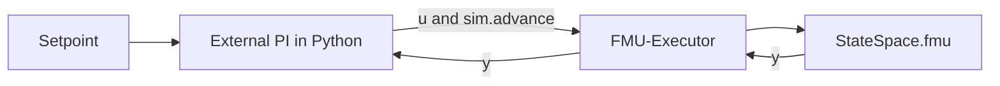

# StateSpace Plant Fixture with an External PI Controller

This example runs the reference FMUs through FMU-Executor's private WebSocket
API. A Python client acts as the external controller, so the PI logic remains
outside the FMU.



## What It Demonstrates

`StateSpace.fmu` implements a linear state-space model. This fixture configures
one input, one state, and one output:

```text
dx/dt = -0.2 x + 0.2 u
y     = x
x(0)  = 0
```

The variables `u`, `y`, and `x` are normalized to the range `[0, 1]`. The plant
has a time constant of 5 seconds. At each communication point, the client
calculates the PI output, clamps `u` to `[0, 1]`, and sends it with
`sim.advance`. It then reads `y` from the returned sample and calculates the
next control value. Initialization uses `sim.initialize` in `external` mode;
each advance includes `currentCommunicationPoint`, `targetTime`, `inputValues`,
and `outputVariables`.

The default settings are a setpoint of `0.6`, `Kp=1.0`, `Ki=0.2`, a simulation
step of `0.1 s`, and a 10-second horizon. Conditional integration prevents the
integrator from accumulating error while `u` is saturated.

Before the PI run, `Feedthrough.fmu` checks signal exchange: the client writes
`Float64_continuous_input=0.7` and verifies that
`Float64_continuous_output` returns the same value. This model does not represent
a dynamic plant.

## Run Locally

On Linux, from the `FMU-Executor` repository root, install the project
dependencies and run the example:

```powershell
python -m pip install -e .
python examples/digital-shadow-pi/run_demo.py
```

The script copies both FMUs to a temporary directory, starts a temporary
FMU-Executor bound to `127.0.0.1`, and creates a development-only token and
synthetic reservation context. It shuts down the service and removes the
temporary data when it finishes. You do not need to copy FMUs into `fmu-data` or
configure Gateway credentials. The worker uses the Executor's standard
isolation.

To run it on Windows or Linux with Docker, build the example image from the
`FMU-Executor` repository root and start it:

```powershell
docker build --file examples/digital-shadow-pi/Dockerfile --tag fmu-digital-shadow-pi:local .
docker run --rm fmu-digital-shadow-pi:local
```

The image contains only the runtime dependencies needed by this example, the
Executor source, and the two reference FMUs. It runs as an unprivileged user,
and the worker uses the Executor's standard isolation. The container does not
mount the host source tree or require Gateway credentials.

Pass script options after the image name:

```powershell
docker run --rm fmu-digital-shadow-pi:local --mode pi --setpoint 0.75 --kp 1.0 --ki 0.2
```

On Linux, you can also run the example with a local Python installation after
installing the project (`python -m pip install -e .`), which installs all
Executor dependencies.

Available script options:

```powershell
python examples/digital-shadow-pi/run_demo.py --mode feedthrough
python examples/digital-shadow-pi/run_demo.py --mode pi --setpoint 0.75 --kp 1.0 --ki 0.2
python examples/digital-shadow-pi/run_demo.py --csv .\state-space-pi.csv
```

The optional CSV contains `time_s`, `setpoint`, `u`, `y`, and `error`. The model
advances in externally controlled time steps and does not represent an
industrial real-time connection.

## Scope

The fixture checks WebSocket signal exchange, internal session authorization,
external time advancement, and the response of a compiled FMU. The reservation
context and plant are synthetic. It does not connect to OPC UA, sensors,
actuators, or physical equipment. A real digital shadow would feed measurements
with their timestamps and quality metadata into the FMU. This demonstration does
not authorize commands to a physical process.
